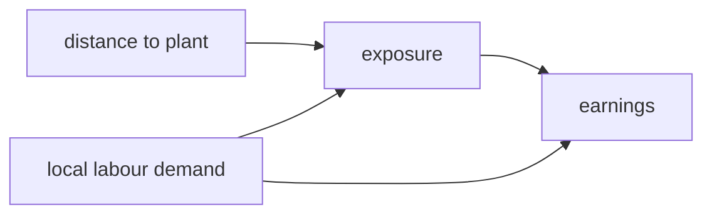

# show-me

Explain the current topic of conversation visually. Keep the prose short and pick the
**smallest** view that carries the point. One visual, placed next to the two or three
sentences it supports — not a gallery.

## Pick the form

**Pseudocode** — for an estimator or a procedure, when the order of operations is the point:

```text
for each bootstrap replicate
  resample clusters, not rows
  re-estimate the first stage
  store the coefficient
report the percentile interval
```

**Pipeline** — for script order and what each stage writes. This is the default for
"where does this number come from":

```text
10_clean.R    →  data/derived/panel.rds
20_sample.R   →  data/derived/analysis.rds
31_main.R     →  output/tab_main.tex
32_robust.R   →  output/tab_robust.tex
```

**Sample-construction waterfall** — whenever the sample is the thing under discussion.
Counts on the right, one restriction per line:

```text
raw wave 6                 128,430
  drop age < 25            -18,204    110,226
  drop missing wage         -9,881    100,345
  drop singleton firms      -2,117     98,228
analysis sample                        98,228
```

**Specification grid** — for comparing columns of a table, or deciding which spec to run:

| | (1) | (2) | (3) |
|---|---|---|---|
| controls | none | demographics | + industry |
| fixed effects | firm | firm | firm + year |
| cluster | firm | firm | firm |

**Mermaid** — for identification, treatment timing, or data flow between sources:



**File tree** — for project layout or a reorganisation, kept shallow:

```text
code/
├── build/     # raw → derived
├── analysis/  # derived → output
└── test/      # verification scripts
```

**Diff** — when the shape already exists and *what changes* is the whole point. Match the
diff to whatever form fits the topic — a spec, a pipeline, a tree:

```diff
 log(wage) ~ treat * post
   + age + age^2
-  | firm
+  | firm + year
   cluster: firm
```

**A small HTML page** — only when the content is genuinely too dense for the above: a
robustness grid across many specifications, a coefficient dashboard, a diagnostic summary
with sections worth collapsing. Self-contained, no CDN. If a script produced the numbers,
have the script emit the page from aggregates so raw rows never enter the chat. Link the
file in the reply; never run `open` on it.

## Boundaries

- Where the session offers an inline visual widget, prefer it for a quick in-conversation
  picture, and write an HTML file when the thing should persist and be reopened later.
- Explaining a **code change** in depth is `explain-diff`, which builds a full teaching
  page. `show-me` is the fast in-conversation sketch.
- Anything that becomes a portable PDF for someone else is a **LaTeX/Beamer** job — use
  `deck`. HTML here is for what you read on screen yourself.

## Guidance

Show only the steps, files, restrictions, or nodes needed to answer the question actually
on the table. You will usually use one of these forms and occasionally two; using all of
them means the point was never identified. If a plain sentence is clearer than a picture,
write the sentence.
